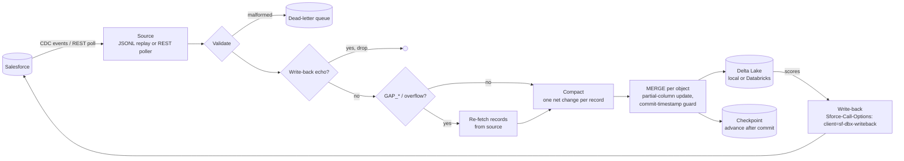

# Salesforce-Databricks Connector

> Keeps Delta Lake tables in sync with Salesforce using Change Data Capture (CDC) semantics: partial updates, deletes and undeletes, gap recovery, and schema evolution, applied with one idempotent `MERGE` per object per batch. Includes governed write-back to Salesforce with feedback-loop prevention.

[](https://github.com/gyaneshwarmalba/salesforce-databricks-connector/actions/workflows/ci.yml)

Runs offline. It replays sample CDC events into real Delta Lake tables on disk using [delta-rs](https://github.com/delta-io/delta-rs), so no Spark, JVM, or cloud account is needed. The same merge logic produces `MERGE INTO` SQL for a Databricks SQL warehouse (Unity Catalog). Sample data is synthetic.

## Architecture



## CDC semantics handled

| Case | Handling |
|---|---|
| **UPDATE carries only changed fields** | Each row records which columns changed (`_changed`). The MERGE sets `col = CASE WHEN instr(s._changed, ',col,') > 0 THEN s.col ELSE t.col END`, so untouched columns keep their values. |
| **Fields set to null** | `nulledFields` become explicit `NULL` writes. |
| **Compound fields** (`BillingAddress`) | Flattened to `BillingAddress_City`; `changedFields` entries like `BillingAddress.City` are mapped to match. |
| **One event, many records** | `recordIds` fan out to one change per record. |
| **DELETE / UNDELETE** | Delete removes the row; undelete re-inserts the full record. |
| **GAP_CREATE / UPDATE / DELETE / UNDELETE** | Records are re-fetched from Salesforce and applied as full rows (or deleted if gone). |
| **GAP_OVERFLOW** | Full resync of the object. |
| **New fields** | Schema evolution: `ALTER TABLE ... ADD COLUMNS` before the merge. |
| **Late or replayed events** | Updates and deletes apply only if `s._sf_commit_ts >= t._sf_commit_ts`. |
| **Malformed events** | Written to a dead-letter file; the batch continues. |

## Delivery guarantees

- **At-least-once reading, idempotent writing.** The checkpoint (last replay id) advances only after every object's MERGE in the batch has committed. A crash means the batch is re-read, and the commit-timestamp guard makes the second apply a no-op. The test suite checks this by replaying the whole stream from scratch and comparing the tables.
- **Batch size doesn't change the result.** Compaction folds each batch to one net change per record, so processing events 1, 2, 3, or 5 at a time yields the same final tables (tested).
- **Retries** use exponential backoff with jitter for transient connection and timeout errors. Other errors fail fast and leave the checkpoint untouched.

## Write-back without feedback loops

`writeback` pushes fields (for example `Churn_Score__c` from a model) to Salesforce through the composite sObject API in batches of 200 with `allOrNone=false`, and reports per-record failures. Every call carries `Sforce-Call-Options: client=sf-dbx-writeback`. Salesforce copies that into the CDC `changeOrigin` of the resulting events, and the connector drops them. Without this, every score update would flow back into Delta and could trigger another scoring run. As a second guard, events from a dedicated `INTEGRATION_USER_ID` can also be filtered.

## Quick start

```bash
git clone https://github.com/gyaneshwarmalba/salesforce-databricks-connector.git
cd salesforce-databricks-connector
python -m venv .venv && source .venv/bin/activate
pip install -r requirements.txt

python -m app.main sync       # replays data/sample_events/account_changes.jsonl
python -m app.main status     # checkpoints, dead letters, table versions and columns
pytest                        # 31 tests, offline
```

`sync` on the sample stream reports 13 events read: 1 write-back echo skipped, 1 malformed event dead-lettered, 1 gap re-fetched, and Account and Contact tables created. You can read the result with any Delta reader:

```python
from deltalake import DeltaTable

DeltaTable("data/state/delta/account").to_pandas()
```

Other commands:

```bash
python -m app.main backfill --entity Account                 # initial load before streaming
python -m app.main sync --follow --interval 30               # keep polling
python -m app.main writeback --from-table <delta path> --entity Account --fields Churn_Score__c --dry-run
```

## Running against Salesforce and Databricks

```bash
pip install -r requirements-cloud.txt
cp .env.example .env   # set SOURCE=salesforce, SINK=databricks and credentials
```

| Component | Setting | Notes |
|---|---|---|
| Source | `SOURCE=salesforce` | Polls `SF_ENTITY` with `SystemModstamp >= watermark` through `queryAll` (which includes deleted rows) and emits CDC-shaped events. It works in any org with no CDC entitlement. |
| Sink | `SINK=databricks` | `MERGE INTO <catalog>.<schema>.<object>` on a SQL warehouse. All values are bound parameters, and identifiers are validated. |
| Write-back | `writeback` without `--dry-run` | Uses the Salesforce credentials from `.env`. |

For push-based streaming at high volume, a Salesforce Pub/Sub API (gRPC) subscriber is the production source. It yields the same decoded CDC payloads, so it plugs into `Source.read()` without changes downstream. It isn't included because it needs generated gRPC stubs and a CDC-enabled org to test against.

## Design decisions

- **delta-rs for the local sink.** It gives real Delta transactions and MERGE in CI in seconds, with no Spark cluster. The Databricks sink shares the same `MergePlan`, so both paths have the same semantics.
- **One MERGE per object per batch** rather than row-by-row upserts. This keeps each commit atomic, keeps the Delta transaction log small, and makes replays cheap.
- **`instr` instead of `LIKE`** for the changed-column test, because `_` is a `LIKE` wildcard and appears in most custom field names.
- **Explicit schema evolution.** New columns are added with `ADD COLUMNS` before merging instead of relying on implicit merge-schema. That makes the change visible in logs and portable to Databricks SQL.

## Project layout

```
app/
  events.py       CDC parsing: partial updates, nulled and compound fields, validation
  compaction.py   fold events into net changes per record
  merge.py        MergePlan: shared MERGE predicates and column expressions
  sinks.py        LocalDeltaSink (delta-rs), DatabricksSqlSink (MERGE INTO)
  sources.py      FileEventSource (replay), SalesforceRestSource (poller)
  connector.py    orchestration, gap and overflow handling, echo filter, stats
  reliability.py  checkpoints, retry with backoff, dead-letter queue
  writeback.py    composite API write-back with client tagging
  main.py         CLI
data/sample_events/   synthetic CDC stream and source snapshot
tests/
```

## License

MIT. See [LICENSE](LICENSE).
